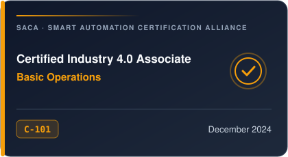
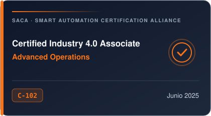
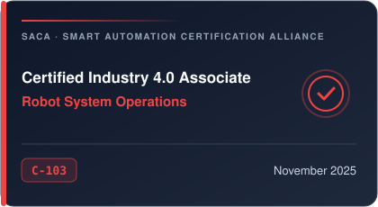
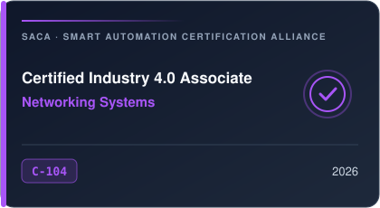
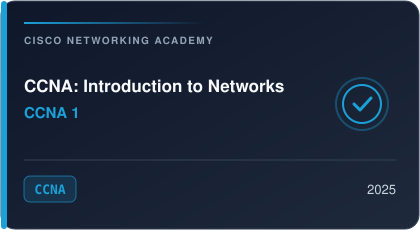
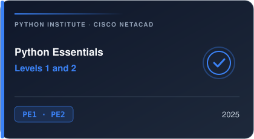
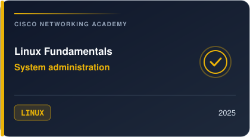

  

  

  
  
  
  

## About Me

I am a **Web Development Technician** graduated from Colegio Técnico Profesional Don Bosco and a **Software Development Engineering** student. I specialize in end-to-end **full-stack** development: from architecture design and data modeling to the user interface, artificial intelligence integration and production deployment.

I build **complete, scalable web platforms**, **real-time data dashboards**, **secure APIs**, **automations** and **AI-powered solutions**, always focused on solving real user needs.

I complement software development with a solid background in **Industry 4.0**, networking and **Linux** system administration, backed by SACA and Cisco Networking Academy certifications. I am known for critical thinking, structured problem solving and teamwork, and my goal is to keep growing toward cloud architecture, cybersecurity and distributed systems.

<table>
  <tr>
    <th align="left" width="50%">Education</th>
    <th align="left" width="50%">Areas of Expertise</th>
  </tr>
  <tr>
    <td valign="top">
      <b>B.S. in Software Development Engineering</b> 
      In progress  
      <b>Web Development Technician</b> 
      Colegio Técnico Profesional Don Bosco — San José, Costa Rica · 2026  
      <b>Languages</b> 
      Spanish (native) · English (advanced)
    </td>
    <td valign="top">
      Multi-tenant SaaS application architecture 
      Full-stack development with Django and Next.js 
      Applied machine learning and generative AI 
      Containers, deployment and Linux servers 
      Industry 4.0, networking and cybersecurity fundamentals
    </td>
  </tr>
</table>

## Featured Project

  

**Vigía** is a SaaS platform that helps medical clinics anticipate operational problems. It monitors 11 indicators —cancellations, no-shows, schedule occupancy, wait times, revenue, retention and NPS, among others—, detects deviations with three complementary algorithms and, for high or critical alerts, uses AI to generate a probable root-cause analysis and concrete actions.

<table>
  <tr>
    <th align="left" width="33%">Backend & Intelligence</th>
    <th align="left" width="33%">Frontend</th>
    <th align="left" width="34%">Infrastructure</th>
  </tr>
  <tr>
    <td valign="top">
      REST API with Django 6 and DRF 
      JWT authentication with automatic refresh 
      RBAC with 6 roles, scoped per clinic and branch 
      Detection: statistics + Prophet + PyOD 
      AI recommendations and copilot with Claude API 
      Async tasks with Celery and Celery Beat 
      Sync with external HIS/ERP 
      Plans and payments with Stripe and Tilopay 
      SMTP email notifications
    </td>
    <td valign="top">
      Next.js 16 (App Router) and React 19 
      TypeScript and Tailwind CSS v4 
      Global state with Zustand 
      KPI charts with Recharts 
      Animations with Framer Motion and GSAP 
      Accessible components with Radix UI 
      Bilingual UI with AI-assisted translation 
      Light and dark themes, guided tour 
      Custom design system and brand guide
    </td>
    <td valign="top">
      Docker and Docker Compose (8 services) 
      PostgreSQL 16 and Redis 7 
      Caddy reverse proxy with automatic TLS 
      Gunicorn and WhiteNoise 
      Deployment on an Ubuntu VPS 
      Automated deployment scripts 
      Secure per-environment secrets management
    </td>
  </tr>
</table>

  
  
  
  

## Tech Stack

### Programming Languages

  
  
  
  
  
  
  
  

### Frontend

  
  
  
  
  
  
  
  
  
  

### Backend & Services

  
  
  
  
  
  
  
  

### Artificial Intelligence & Data Science

  
  
  
  
  
  

### Databases

  
  
  
  
  
  
  

### DevOps, Infrastructure & Tools

  
  
  
  
  
  
  
  
  

### Concepts & Practices

| Area | Skills |
|:--|:--|
| Software architecture | Multi-tenant SaaS, REST APIs, frontend/backend separation, queue-based async processing |
| Application security | JWT authentication, password hashing, RBAC, per-tenant data isolation, secrets management |
| Data & artificial intelligence | Anomaly detection, time series, machine learning, LLM integration, vector databases |
| Integrations | External hospital systems (HIS/ERP), payment gateways, transactional email, webhooks |
| DevOps | Containerization, Compose orchestration, reverse proxy, TLS, Linux server deployment |
| Infrastructure | Networking, Industry 4.0, Linux administration, cybersecurity fundamentals |

## Certifications

### Smart Automation Certification Alliance (SACA) — Industry 4.0

An internationally recognized industrial certification path focused on advanced manufacturing operations, robotics, automation and industrial networking.

  
  

  
  

### Cisco Networking Academy & Python Institute

  
  
  

## GitHub Activity

  
  

  

  

